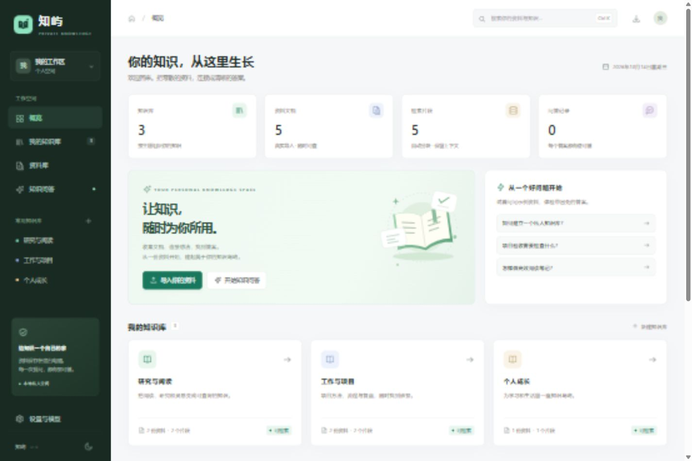

# 知屿 · 私人知识库

把零散的资料连接成可以查询的知识。适用于个人阅读、项目资料和学习笔记。



## 启动

[下载 Windows 运行包](https://github.com/ZTLNB/zhiyu/releases/latest)，解压后双击 **启动知屿.cmd**，浏览器会打开 http://127.0.0.1:8787。
双击 **停止知屿.cmd** 可结束后台服务。启动后不必安装 Node、Python、Docker 或数据库。

如果下载的是仓库源码，请先按下方“开发”步骤构建 `zhiyu.exe`。

首次启动会载入五份明确标注的示例资料，可以直接试用问答与出处查看。资料、对话和模型设置保存在本目录的 `data/`，不会写入系统目录。

## 已实现

- 多知识库创建、切换与删除（删除前需清空资料）。
- PDF、DOCX、MD、TXT、CSV 导入，批量上传、拖拽上传、重复内容识别。
- 中文字符分块、上下文重叠、文档页码保留、可配置分块长度。
- 中文双字词与英文词的 BM25 排序检索，按知识库隔离。
- 原文摘录问答，点击引用打开原文及引用片段。
- 兼容 chat/completions 的模型连接、测试和带检索资料的生成回答。
- 对话保存、续问、复制、删除；删除原文后保留对话引用快照。
- 本机数据持久保存、完整备份导出、备份恢复和恢复前自动备份。
- 响应式界面、深浅主题、键盘快捷键。

## 模型配置

在“设置与模型”填写服务的 API 地址、模型名称和密钥，然后保存并测试。地址可以是基础地址（例如 `https://your-service/v1`），也可以是完整的 `chat/completions` 地址。本地兼容服务可以使用 `http://127.0.0.1:端口/v1`；不需要鉴权时密钥留空。

未配置模型时，系统直接返回资料中的原文摘录，不会伪装成模型回答。开启“模型生成回答”后，问题、相关片段与最近六条消息会发送至配置的模型。密钥由本地服务端保存，不会从状态接口或导出备份返回；`data/` 应视为私人数据。

## 使用范围

- PDF 必须含文字。扫描 PDF 暂不提供 OCR。
- DOCX 以提取后的文本视图展示，页数显示为文本视图页数，不还原 Word 排版。
- 检索采用关键词排序，当前不包含向量嵌入、重排模型、知识图谱或团队权限。
- 单文件最大 20 MB；恢复备份当前最大 26 MB。
- 分块参数对之后导入的资料生效。
- 服务只监听本机环回地址，不适用于直接部署为多人公网服务。

## 开发

Go 1.24 或更高版本，无第三方 Go 模块依赖。前端为原生 HTML、CSS、JavaScript，静态资源编译进程序。

GitHub Actions 会在 Windows 和 Linux 上执行测试与构建。

```powershell
./build.ps1
./zhiyu.exe -port 8787 -data ./data
```

`build.ps1 -Go "C:\path\to\go.exe"` 可选择工具链。所有验证通过后才生成程序。

结构：`main.go`（本地 HTTP 服务与持久化）、`retrieval.go`（检索）、`internal/chunk/`（分块流水线）、`web/`（界面）、`legal/`（依赖许可）。

保留 `LICENSE`、`NOTICE` 和源码中的版权标记，随源码或程序一起分发。
